  

  
  
  
  

  <em>Building systems where embedded control, computer vision, and hardware bring-up have to work together — not just demo in isolation.</em>

  

## Technical skills

  

  

  
  
  
  
  
  

## Selected portfolio work

<table>
<tr>
<td width="50%" valign="top">

 
Camera-guided model car with embedded steering and speed control, custom electronics integration, ultrasonic braking, and real-time tuning workflows.
  
<strong>Proof:</strong>
<a href="https://raw.githubusercontent.com/IvanFuentesB/delete/main/assets/case-studies/diagrams/svg/nxp_01_electrical_architecture.svg">Electrical architecture</a> ·
<a href="https://raw.githubusercontent.com/IvanFuentesB/delete/main/assets/case-studies/diagrams/svg/nxp_03_vision_pipeline.svg">Vision pipeline</a> ·
<a href="https://raw.githubusercontent.com/IvanFuentesB/delete/main/assets/case-studies/diagrams/svg/nxp_04_braking_state_machine.svg">Braking state machine</a>
</td>
<td width="50%" valign="top">

 
Multi-device platformer where physical colored shapes detected by camera are published through MQTT and mapped into game progression.
  
<strong>Proof:</strong>
<a href="https://raw.githubusercontent.com/IvanFuentesB/delete/main/assets/case-studies/diagrams/svg/sda_01_multidevice_architecture.svg">Architecture</a> ·
<a href="https://raw.githubusercontent.com/IvanFuentesB/delete/main/assets/case-studies/diagrams/svg/sda_02_cv_pipeline.svg">CV pipeline</a> ·
<a href="https://raw.githubusercontent.com/IvanFuentesB/delete/main/assets/case-studies/sda-pdf-real-images/sda_pdf_09_sequence_diagram.png">Sequence diagram</a>
</td>
</tr>
<tr>
<td width="50%" valign="top">

 
CPU-friendly expression-to-avatar reaction prototype that turns face and hand landmarks into a separate hamster reaction panel in real time.
  
<strong>Proof:</strong>
<a href="https://raw.githubusercontent.com/IvanFuentesB/delete/main/assets/case-studies/diagrams/svg/doodle_01_live_inference_pipeline.svg">Live inference</a> ·
<a href="https://raw.githubusercontent.com/IvanFuentesB/delete/main/assets/case-studies/diagrams/svg/doodle_02_training_pipeline.svg">Training pipeline</a>
</td>
<td width="50%" valign="top">

 
Supervised AI operator framework centered on approval-aware execution, reviewable outputs, explicit boundaries, and local-first tooling.
  
<strong>Proof:</strong>
<a href="https://raw.githubusercontent.com/IvanFuentesB/delete/main/assets/case-studies/diagrams/svg/ghoti_01_supervised_operator_architecture.svg">Operator architecture</a> ·
<a href="https://raw.githubusercontent.com/IvanFuentesB/delete/main/assets/case-studies/diagrams/svg/ghoti_02_safety_boundary.svg">Safety boundary</a>
</td>
</tr>
</table>

## GitHub stats

  

  
  

  

## What I work on

- Embedded control and autonomous systems
- Computer vision for real-world interaction
- Robotics projects that cross software, hardware, and communications
- Technical tooling that stays explicit about limits, validation, and safety

<strong>Repo map</strong>

 

- [SDA_Group_Project](https://github.com/IvanFuentesB/SDA_Group_Project): computer vision platformer with architecture, CV pipeline, and supporting documentation evidence.
- [Doodle-Hamster-Cam](https://github.com/IvanFuentesB/Doodle-Hamster-Cam): landmark-driven expression-to-avatar prototype with collection, mapping, training, and live inference workflows.
- [Super-AI-Agent](https://github.com/IvanFuentesB/Super-AI-Agent): approval-aware AI operator framework with explicit non-features and safety boundaries.

## Contact

- LinkedIn: [linkedin.com/in/ivan-fuentes-bedereu-0587b620b](https://www.linkedin.com/in/ivan-fuentes-bedereu-0587b620b/)
- Email: [ivanfb05@gmail.com](mailto:ivanfb05@gmail.com)
- Based in Eindhoven, NL

  

